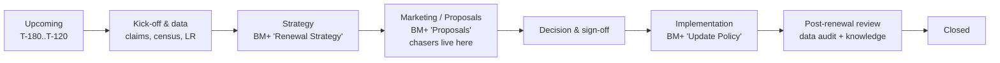

# MART — Renewal lifecycle & project management (planning draft)

> Status: **planning only, nothing built.** This is a picture of what is
> possible plus open questions. Everything here can still change.
> Source material: a read-through of the MAPT NEO repository (trackers, data
> model, follow-ups/chasers, to-dos, meetings, audits).

---

## 1. What MART is (and how it differs from MAPT NEO)

| | MAPT NEO | MART |
|---|---|---|
| Main question | "What does the book look like?" | "What do I have to do, by when, and is it on track?" |
| Main unit | Policy / coverage / period | The **renewal case**: one policy's renewal cycle, treated as a small project |
| Time horizon | Snapshot of the current trackers | The **whole lifecycle**, from the first signal before the renewal to the post-renewal review, **kept after BM+ forgets it** |
| Work features | Bolted on over time (Follow-ups, chasers, to-dos, meetings, audits are separate things) | Built around one model: case → phase → work items → reminders |

MAPT NEO already has many project-management pieces (the Follow-ups queue,
the chaser ladder, the contact log, the to-do Kanban). They were added to an
analytics app, though, and each one keys itself to the renewal in its own way.
MART puts the **renewal case** at the centre and hangs everything else off it.

---

## 1b. What Martin wants to be able to do (round 2 input)

MART = **Martin's Awesome Renewal Tool**.

1. **Orient myself on opening it.** A summary of my clients with their notes
   and to-dos. My **local AI agent connects over MCP**, reads the database and
   helps organise my day.
2. **Client → renewals, bundled.** Selecting a client shows all of their
   renewals **bundled by country + renewal date**. Selecting a bundle shows
   its individual renewals.
3. **Kanban with colleagues: show the *real* state.** BM+ often lags reality.
   For example, the strategy is already agreed, but the broker hasn't
   submitted it in BM+ yet. I need to be able to record the actual state and
   **point out the discrepancy**.
4. **Overview freshness + broker deadlines.** See which policies have **new**
   renewal overview comments and which are **stale**. When a broker gives an
   expected date for an update, I can record it as a **deadline**.
5. **Notes and to-dos on renewals.**

### What this settles

- Q25 (MCP/AI agent): **yes**, from day one, and as part of the daily routine.
- Q8 (unit): the natural grouping is the **bundle = client × country ×
  renewal date**. It can be derived automatically from the trackers; no manual
  grouping is needed.
- Q10 (who wins): **neither overwrites the other.** BM+ state and actual state
  are kept side by side, and the *difference* is a first-class thing to see
  and act on.

---

## 1c. The screens

### Home — "where am I?"
One card per client, ranked by what needs attention:

- renewals in flight and the next renewal date
- 🟢 new overview comments since I last looked · 🟠 stale overviews
- broker deadlines passed or due this week
- open discrepancies (actual state ≠ BM+)
- open to-dos (count + the next few) and the latest note

Above the cards is a **"Today"** strip: deadlines due, to-dos due, overdue
broker promises. The AI agent's day plan (written over MCP) can appear here
as a note or a set of to-dos it created.

### Client page — renewals by bundle
```
Mercedes-Benz Group AG
├─ Poland · 01.01.2027            3 renewals   strategy: Remarketing (actual) ≠ BM+ blank ⚠
│    ├─ Life           Allianz    overview 3d ago 🟢
│    ├─ Medical        PZU        overview 41d ago 🟠   broker promise: 15.11 ⏰
│    └─ Disability     Allianz    …
├─ Spain · 01.01.2027             2 renewals
└─ Brazil · 01.03.2027            1 renewal
```

- A bundle row rolls up its renewals: the worst freshness, the soonest
  deadline, the stage mix, and discrepancies.
- Clicking a bundle opens its renewals. Clicking a renewal opens the
  **renewal drawer** (BM+ facts, the actual-state panel, the overview
  timeline, notes, to-dos and deadlines).
- Notes, to-dos and deadlines can be attached at **bundle** level (they apply
  to all renewals in it, like one email covering several policies) or at
  **renewal** level.

### Kanban — the shared picture when working with colleagues
- Columns = stages. **The card sits in the column of its *actual* state.**
  If BM+ shows something different, the card carries a badge such as
  "BM+: Strategy — not started".
- Dragging a card records an actual-state change, with an optional one-line
  reason ("agreed with HR on call 28.10").
- The cards could be bundles or individual renewals (see Q-B2).
- Filters: client, country, owner, "only discrepancies", "only stale".

### Overview freshness
- **New** = an overview entry dated after the last time I marked it seen
  (or after a reference point such as the last meeting).
- **Stale** = no overview entry for N days. N could tighten as the renewal
  date approaches (see Q-C1).
- MAPT already parses dated `DD MMM YYYY:` entries out of the overview and
  stores `latest_overview_date`. This can be reused directly.

### Broker deadlines ("they said they'd update by …")
- A **deadline** = (renewal or bundle, who promised, what, expected date,
  source note).
- **Fulfilled automatically** when a new overview entry dated on or after the
  promise appears in BM+, or manually ticked.
- **Overdue** → it appears on Home/Today, and a chase can be started
  (chaser ladder, with a ready-to-send draft as in MAPT).

---

## 1d. "Actual state" vs BM+: the discrepancy model

This is the most distinctive feature, so it gets its own design.

- **Per renewal, per field**, MART can hold *my* value next to BM+'s value.
  Candidate fields: stage (Strategy / Proposals / Update Policy / done),
  upcoming strategy, workflow status, plan design changes yes/no, new insurer,
  expected effective date.
- Each assertion stores: value, who and when, an optional reason/evidence
  note, and **the BM+ value at the time it was made**.
- Every view computes three states:
  - **in sync**: BM+ = actual (or no actual recorded, so BM+ is shown)
  - **BM+ behind**: actual is ahead → "broker to submit in BM+". This is
    itself a follow-up item, possibly a deadline or a chase
  - **conflict**: BM+ moved to something *different* from what I asserted →
    needs my look
- **Self-healing**: when an ingest brings BM+ in line with my value, the
  discrepancy closes and is logged ("BM+ caught up on 04.11"). Nothing has to
  be cleaned up by hand.
- This generalises MAPT's `renewal_strategies` pattern (an answer stored
  *beside* the tracker, BM+ wins once it has one). In MART the actual state
  wins *on the board*, and BM+ wins as the record. Both are shown.

---

## 2. What we learned from the MAPT trackers

### 2.1 The four BM+ exports

| Tracker | Grain | What it gives MART | Watch-outs |
|---|---|---|---|
| **Task Tracker** (`Task Summary`) | one BM+ task | the three BM+ stages per renewal (**Renewal Strategy → Proposals → Update Policy**), status, assignee, escalation manager, due date, times escalated | full SNAPSHOT per client: tasks that vanish are deleted. Two export flavours (cross-client / client-specific). BM+ keeps a finished cycle's tasks unless they are marked Completed, so they have to be scoped to the cycle by `Policy Renewal/Review Date` |
| **Renewal Tracker** (`Renewal Overview`) | one in-progress renewal | workflow status, upcoming strategy, year of last remarketing, plan-design changes + comments, target/actual loss ratio, claims comments, multinational network (MNW) expiring vs upcoming, **dated overview text** (all + client-ready) | **completed renewals are dropped on every ingest.** MAPT does not read the `Renewal Strategy`, `Proposals` and `Savings` sheets yet, and those are exactly what a post-renewal review needs |
| **Benefit Tracker** (BD / PCD / CD sheets) | policy, coverage, period, plan design | the **result** of a renewal: new period, dates, premium, headcount, insurer, design, Rate Guarantee End, Total Savings at Last Renewal, Prior Renewal Strategy, benchmarking | this is the "did BM+ get updated?" source. Only the current period is in each file, so history builds up across uploads |
| **Insurer Capability DB** | network × country × line | network partner checks | global snapshot |

### 2.2 The glue (reuse as-is)

- **Expiring policy unique id**: the one id that stays the same across
  cycles (`Benefit Unique ID` = `Expiring Policy Unique ID` = `Policy Unique ID`).
- **Cycle**: a renewal is (expiring id, renewal/review date), or BM+'s
  `Renewal Unique ID`. MAPT had to derive the cycle after the fact
  (`CURRENT_CYCLE_SQL`). In MART the cycle is a first-class object.
- **(scope, ref)**: the convention for notes, links and to-dos. It works and
  is worth copying.
- NULL means "to be confirmed", not zero. Trust BM+ task status rather than
  recomputing it. Count deadlines in **working days**.

### 2.3 What has to be corrected or rethought for MART

1. **History must outlive BM+.** The Renewal Tracker drops completed
   renewals and the Task Tracker deletes vanished tasks. A post-renewal phase
   is impossible if the case disappears at the moment it completes. MART
   owns the case, and BM+ data only *updates* it.
2. **Record changes, not only state.** Each ingest should record what
   *changed*: "Proposals went In Progress → Completed, first seen 12.03".
   Without that there is no timeline, no cycle time and no "what moved since
   my last meeting". Note: BM+ does not export *when* something happened.
   MART only knows when it **first saw** it, so accuracy depends on how often
   you upload.
3. **BM+'s three stages are too coarse to manage by.** They are a reporting
   skeleton. The real work (claims data request, broker brief, quotes,
   client sign-off, BM+ update, audit, savings write-up) sits inside them.
   MART needs **its own phases** and maps BM+'s stages onto them.
4. **Plan backwards from the renewal date.** The deadline never moves, so
   every step's due date should be computed from it (T-120, T-90, …, in
   working days). The case's health is then *planned vs actual*, and you
   are warned before the deadline is at risk, not after.
5. **Bundles are real.** One mail covers several policies, and one client and
   country often renews together. MAPT's contact log had to add `n_refs` for
   this. MART should allow cases to be grouped and moved together.
6. **One reminder engine**, not chasers + to-do reminders + attention badges
   as three separate mechanisms.

---

## 3. What matters in a project-management tool, applied to renewals

| PM concept | Renewal translation |
|---|---|
| Project | **Renewal case** (one policy × one cycle), optionally in a **bundle** (client/country) |
| Project template / playbook | **Renewal playbook**: phases + checklist items + relative deadlines. Variants by strategy (incumbent / remarketing / rate guarantee / non-expiring), possibly by product group or country |
| Milestones | Phase gates: strategy agreed, terms received, client decision, BM+ updated, review passed |
| Tasks | BM+ tasks (mirrored, read-only) **+** playbook items **+** your ad-hoc to-dos, all on the same case |
| Status | Phase (where it is) **+** health/RAG (on track?) **+** **ball in court** (us / broker / insurer / client / COE). Much of a renewal is waiting on someone, so "waiting on whom, since when" is the key field |
| Deadlines | Absolute (renewal date) and relative (T-minus working days) |
| Reminders | Due-date alarms, chaser ladder rungs, snooze, "remind me if no answer in N WD" |
| Dependencies / blockers | "Can't request quotes until claims data is in". Light, at checklist level only |
| Board (Kanban) | Columns = phases, cards = cases, swimlanes = client / renewal month / owner |
| Calendar / timeline | Renewal dates + back-scheduled milestones, exported to Outlook (.ics, as MAPT already does) |
| My Day / inbox | Today's due + overdue + replies to read + chasers due, in one list |
| Activity log | Append-only timeline per case: BM+ changes, your actions, contacts, notes |
| Definition of done | Post-renewal review checklist (data audit + knowledge captured) |
| Reporting | Cases per phase, overdue, cycle time per phase, savings achieved, audit pass rate |

---

## 4. A proposed renewal lifecycle (to be corrected by you)



Each phase has:

- **entry/exit criteria**, either *automatic* from tracker data (for example,
  "Strategy" can exit when BM+ has an Upcoming Renewal Strategy or the
  Renewal Strategy task is Completed) or *manual* checklist ticks;
- **playbook items**, each with a relative due date;
- an **expected duration**, which gives the health (RAG) colour.

How BM+ and MART interact: BM+ statuses move the case *forward
automatically* where a rule says so. You can always move it manually. What
happens when the two disagree is open question Q10.

### 4.1 Post-renewal review: the part MAPT doesn't do

MAPT's audit checks the *quality of one Benefit Tracker file*. A post-renewal
review is different. It checks a **before → after delta for one case**:
did the new cycle land in BM+ correctly? Candidate checks, all derivable from
data MAPT already ingests:

| Check | Source |
|---|---|
| New period exists; start = old end + 1 day; end/next renewal date set | Benefit Tracker BD/PCD |
| Premium and headcount **updated**, not just copied from last year (identical value = suspicious) | PCD period vs previous period |
| Insurer matches the decision (remarketing win means a new carrier) | BD insurer vs strategy/outcome |
| Prior Renewal Strategy = what was actually decided | BD `Prior Renewal Strategy` vs case |
| Year of Last Remarketing updated if remarketed | BD / Renewal Tracker |
| Rate Guarantee End Date set if renewed with a rate guarantee | BD |
| **Total Savings at Last Renewal** filled (23% fill rate in the sample!) | BD |
| Plan design changes = Yes → coverage design actually differs between periods, and the changes are described | Renewal Tracker + CD sheets diff |
| Loss ratio / claims period refreshed | PCD claims block |
| MNW upcoming = implemented after renewal | Renewal Tracker → PCD |
| Client-ready overview has a final entry | Renewal Tracker overview |
| BM+ tasks all Completed | Task Tracker |

Then the **knowledge capture** items: record the savings (amount, basis,
type), record the plan design changes (what, from → to, effective date),
lessons learned. Whether these feed a register, a report or the MAPT dossier
is open question Q16.

Findings can be **waived** ("accepted, not applicable"), so they don't nag
forever. The MAPT audit plan already identified waivers as an open point.

---

## 5. Kanban board — first sketch

- **Columns** = lifecycle phases (§4). The Closed column prunes itself after N days.
- **Cards** = renewal cases (or a bundle card that expands). The card shows
  client · country · product group · renewal date countdown · strategy pill
  · ball-in-court · next action + its due date · RAG dot · BM+ stage strip
  (3 mini dots) · chaser badge.
- **Swimlanes** (switchable): none / client / renewal month / owner / strategy.
- **Filters**: same live-filter pattern as MAPT (client, country, product
  group, strategy, owner, health, "only waiting on others").
- **Drag** = move phase. Phase gates can warn ("2 exit items open") but should
  not block.
- **Drawer** on click: a timeline, the checklist per phase, chasers and
  contacts, notes. Same layout as MAPT's renewal drawer, so it is familiar.
- Other views on the same data: **list**, **calendar/timeline**
  (back-scheduled milestones), **My Day**.

---

## 6. Sketch of the data model

```
clients, policies              mirror of BM+ (reused ingestion, read-only)
renewal_cases                  id, expiring_policy_id, cycle_key (renewal_unique_id | review date),
                               client, country, product_group, renewal_date, strategy,
                               phase, health, ball_in_court, owner, bundle_id,
                               opened_at, closed_at          ← MART-owned, never dropped
bundles                        client × country × renewal date (derived; overridable?)
actual_state                   case_id, field, value, bm_value_at_assertion, reason,
                               asserted_by (user|AI), asserted_at, resolved_at, resolution
deadlines                      (scope, ref) bundle|case, promised_by, what, expected_date,
                               source, fulfilled_at, fulfilled_by (overview entry|manual)
seen_marks                     per case: last time I acknowledged its overview (→ "new")
playbooks (config YAML)        phases, items, relative due offsets (WD), gate rules, variants
work_items                     case_id, phase, title, source (bm+|playbook|manual|review),
                               due_date, status, assignee, waiting_on, depends_on
reminders                      target (scope, ref), remind_at, rule, snoozed_until, done
chasers / contact events       as in MAPT (ladder + who-reached-out/who-answered)
case_events                    append-only timeline: observed BM+ changes + user actions
review_checks                  case_id, check_id, result, value_before/after, waived_by/why
knowledge                      savings records, plan design change records, lessons
notes                          (scope, ref) comments, as in MAPT
```

The playbook and the review checks live in YAML, like MAPT's specs and audit
rules: one place, editable without touching code.

---

## 7. Options for the relationship to MAPT NEO

| Option | Pros | Cons |
|---|---|---|
| **A. A new module inside MAPT NEO** | zero duplication, one upload | MAPT is already large; the PM model would be squeezed into an analytics app's shape again |
| **B. Separate app reading MAPT's DB** (read-only) + its own DB for PM data | no second ingestion; MAPT stays the BM+ mirror | coupled to MAPT's schema; MAPT drops completed renewals, so MART must snapshot anyway; two apps to run |
| **C. Separate app with its own ingestion** (reuse MAPT's spec-driven readers, cleaned up) | clean model built around cases; free to fix the history problems | some duplicated code; uploads go to two places (unless MART becomes the successor) |

Leaning: **C, on the same stack** (Python · FastAPI · SQLite · Jinja + HTMX,
no build step, local and single-user), copying MAPT's ingestion layer and
correcting it as described in §2.3. This depends on Q1–Q5.

---

## 8. Possible build order (once the questions are answered)

Re-ordered after round 2, so that the things Martin described come first:

1. **Backbone**: reused ingestion → `renewal_cases` + derived bundles +
   change events, with overview entries parsed (freshness comes for free)
2. **Client page** (renewals by country × date) + **renewal drawer** with
   notes and to-dos
3. **Home** (client cards + Today) and the **MCP server** (reads + user-data writes)
4. **Broker deadlines** + overview new/stale + seen-marks
5. **Actual state + discrepancies** + the **Kanban board**
6. Reminders / chasers / Outlook .ics
7. Playbook YAML + back-scheduled work items + health
8. Post-renewal review checks + waivers, then knowledge capture (savings /
   plan design) + reporting

---

## 9. Questions & clarifications

### Round 2: new questions from Martin's picture

**A. Home & the AI agent**
- **Q-A1.** On a client card, which 3–5 things matter most at a glance?
- **Q-A2.** What should the AI agent be allowed to *write*? (Proposal: notes,
  to-dos, deadlines, seen-marks, actual-state *suggestions* you confirm.
  Never BM+ data.)
- **Q-A3.** Should the agent's day plan be shown in MART (a "Today" list it
  fills), or does it live in the agent's own chat and only *read* MART?

**B. Bundles & the board**
- **Q-B1.** Bundle = client × country × **exact** renewal date, or the same
  month? Does entity matter (two entities in one country, same date)?
- **Q-B2.** Kanban card = bundle or individual renewal? What happens when one
  renewal in a bundle diverges (e.g. different strategy or stage)?
- **Q-B3.** Which columns? A proposal: *Not started · Strategy · Proposals /
  Marketing · Decision · Update Policy · Post-renewal review · Done.*
- **Q-B4.** "Working with my colleagues": do you share your screen in a call
  (MART stays single-user), or should colleagues open MART themselves?

**C. Freshness & deadlines**
- **Q-C1.** When is an overview *stale*: a fixed number of days (MAPT warns at
  N days), or tighter as the renewal date approaches?
- **Q-C2.** "New" relative to what: since I last *marked it seen*, since the
  last client meeting, or since the last upload?
- **Q-C3.** Freshness on *all* overview entries, or on client-ready ones only?
- **Q-C4.** Is a broker deadline fulfilled by any new overview entry, or
  should I always confirm it myself?
- **Q-C5.** When a deadline passes: just flag it, or start a chase (with a
  draft email) automatically?

**D. Discrepancies**
- **Q-D1.** Which fields are typically out of sync besides the strategy
  (stage, workflow status, plan design changes, insurer, dates)?
- **Q-D2.** Should a "BM+ behind" discrepancy automatically become a follow-up
  for the broker ("please submit the strategy in BM+")?
- **Q-D3.** Do you need a list or export of all discrepancies, e.g. to send
  to the brokers or COE?

**E. Notes & to-dos**
- **Q-E1.** MAPT already holds notes, to-dos, chasers and meetings on these
  renewals. Should MART **take them over** (migrate), **share** MAPT's tables,
  or start fresh? (This is Q1 again, and it is now the most important open
  decision.)

### Round 1 questions (status)
Answered or partly answered by round 2: **Q8** (bundle), **Q10** (side by
side), **Q25** (MCP yes). The rest are still open.

### Scope & setup
- **Q1.** Is MART meant to sit *alongside* MAPT NEO, *replace* it eventually, or become part of it? Should it share MAPT's database or have its own?
- **Q2.** Who uses it: only you, or colleagues too (COE analysts, account specialists, managers)? Multi-user changes hosting, login and assignment.
- **Q3.** What is your role in the renewal? Which steps do *you* do, and which do COE, the local broker, the insurer and the client do?
- **Q4.** Where does it run? Same as MAPT (local Windows laptop, OneDrive folder, `.bat` launcher)? Any corporate restrictions (installs, cloud, Outlook automation)?
- **Q5.** Same tech stack OK, or do you want something different (e.g. a richer front end)?

### The lifecycle
- **Q6.** Can you walk me through one real renewal end to end, with typical timings (T-minus)? Is there an internal playbook or SLA document?
- **Q7.** Does the process differ by strategy (remarketing vs incumbent vs rate guarantee / non-expiring / multi-year), product group or country?
- **Q8.** What is one card on the board: a single policy, or a client/country bundle that renews together? How many live renewals at once (≈50? 300?)
- **Q9.** When does a renewal *start* for you, and when is it really *done*?
- **Q10.** If you move a card ahead of BM+ (or BM+ is ahead of you), who wins? Should BM+ ever move a card automatically?
- **Q11.** Is "Annual Renewal/Review Date" the policy's effective renewal date, or a review date before it? Which date should deadlines count back from?

### Tasks, chasers, reminders
- **Q12.** Is MAPT's chaser ladder (5 COE rungs + 3 AS rungs, working days) still correct? Do you need country holiday calendars?
- **Q13.** How should reminders reach you: in-app only, Outlook calendar (.ics), email, Teams, phone? What is technically allowed on your work machine?
- **Q14.** Do you want "waiting on X since Y" and simple dependencies, or is a checklist enough?
- **Q15.** Should BM+ tasks only be mirrored, or should MART's playbook also contain your own sub-steps inside each BM+ stage?

### Post-renewal
- **Q16.** "Updating our internal knowledge on savings / plan design changes": where does that live today (an Excel savings log, SharePoint, a stewardship report, BM+ itself)? What format does it need?
- **Q17.** How are savings defined and calculated (vs the renewal ask? vs the expiring premium? vs the best alternative quote? which currency)? Could you share an anonymised sample of the Renewal Tracker's `Savings`, `Proposals` and `Renewal Strategy` sheets? MAPT doesn't read them yet.
- **Q18.** Which fields *exactly* must be correct after a renewal? Is the list in §4.1 right, and what is missing?
- **Q19.** Should the post-renewal review *block* closing a case, or only be a checklist with waivers?

### Data & history
- **Q20.** Which trackers will you upload, and how often? (Upload frequency limits how accurately MART can date events.) Any new sources: Jira, Outlook mails, meeting notes?
- **Q21.** Should MART keep every completed renewal forever, so each policy has a year-over-year renewal history (strategy, outcome, savings, cycle time)?

### Board & views
- **Q22.** Which board columns do you picture: the phases in §4, BM+'s three stages, or your own? Swimlanes? WIP limits?
- **Q23.** Besides the board, which views matter most: My Day, calendar/timeline, per-client, a management summary?

### Reuse from MAPT NEO
- **Q24.** Which MAPT features should come along (meetings & agenda, Client Room, partner tracker, dossier, contact log, MCP/AI agent), and which stay in MAPT?
- **Q25.** Should your AI agent work with MART over MCP (e.g. "what's overdue", "log this reply", "draft the chaser")?
